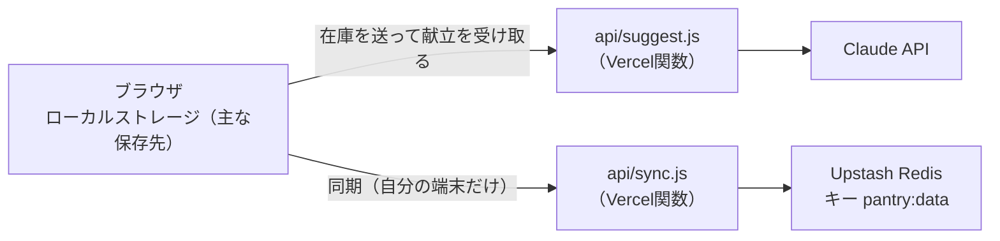

# pantry-chef 設計書とClaude Code指示文

Nov 20, 2026 · @MIWA UENO

## 方針と範囲

pantry-chefは、家にある食材を期限が近い順に使い切る献立をAIが提案し、足りない物だけを買い物リストにするアプリ。「スーパーで買ってから献立」を、「在庫から献立、足りない分だけ買う」に逆転する。ポートフォリオとして公開する。

### 決めたこと

| 項目 | 決定 |
| --- | --- |
| 目的 | フードロス削減、賞味期限管理、適正在庫、レシピのバリエーション、買い物回数の削減、食費の節約 |
| 公開 | ポートフォリオとしてVercelで公開 |
| レシピの出どころ | Claude APIで提案させる |
| 食材の初期登録 | CSV取り込みは初回だけ。日々は少数の食材を手入力する |
| 公開版のデータ | 実際の在庫は入れず、サンプルデータを同梱する |
| 利用者 | 実際に使うのは自分だけ。ポートフォリオの閲覧者はサンプルデータで試す |
| 保存先 | ブラウザ内のローカルストレージを基本にする。自分だけは「自分専用の同期」でPCとスマホのデータをそろえる（保存先はUpstash Redis、Vercel関数経由）。閲覧者のデータは閲覧者のブラウザにだけ保存する |
| 既存の食費管理アプリ（前提） | 別アプリとして新規に作る。連携は段階3で検討 |
| 食材一覧の形式（前提） | スプレッドシートをCSVにして取り込む |

### 機能の段階

教材の進め方どおり、一度に全部作らず段階に分ける。各段階で動作確認し、GitHubにプッシュしてから次へ進む。

| 段階 | 機能 |
| --- | --- |
| 1（核） | 在庫一覧（名前・数量・単位・賞味期限・保管場所）、期限が近い順の色分け表示、手入力の最短化、初回CSV取り込み、サンプルデータ読込、データの書き出し（バックアップ）、AIが献立を3案提案（期限優先）、足りない食材だけの買い物リスト、入力・出力の上限、自分専用の同期（PCで作ったデータを買い物中にスマホで見る） |
| 2 | 品目ごとの適正在庫量（最低在庫を下回ったら買い物リストへ）、使った・捨てた記録（捨てた金額も）、サーバー側の回数制限（同期と同じUpstash Redisを使う） |
| 3 | 最近作った料理を避ける提案、食費管理アプリとの連携 |

## 全体の構成

ブラウザが在庫を持ち、AIの呼び出しはVercel関数が受け持つ。APIキーを知っているのは、この関数だけにする。自分専用の同期も同じくVercel関数が受け持ち、Upstash Redisの接続情報は関数だけが知る。



ブラウザからClaude APIやUpstash Redisを直接呼ぶ構成にはしない。APIキーや接続情報がブラウザに届くと、公開URLを開いた誰でも取り出せてしまうため。Upstashへの読み書きは、必ず `api/sync.js` を経由する。

## データと画面

食材は1品ごとに1件のデータとして持ち、ブラウザのローカルストレージ（キー `pantry-items`、JSON形式）に保存する。同期を有効にした端末では、これに加えてUpstash Redisにも保存する（「自分専用の同期」を参照）。

名前の候補と、同じ食材の前回の単位・保管場所は、ローカルストレージのキー `pantry-history` に食材名ごとに保存する。使い切って一覧から消えた食材も候補に残す。

### 食材のデータ

| 項目 | 型 | 説明 |
| --- | --- | --- |
| `id` | 文字列 | 自動で付ける |
| `name` | 文字列 | 食材名 |
| `quantity` | 数 | 数量 |
| `unit` | 文字列 | 個・g・本・パックなど |
| `expiry` | 日付 | 賞味期限または消費期限。不明なときは空 |
| `location` | 選択 | 冷蔵・冷凍・常温 |
| `addedAt` | 日付 | 登録日。自動 |

段階2で、最低在庫量（`minStock`）と価格（`price`、捨てた金額の計算用）を足す。

### 手入力を最短にする工夫

CSVは初回だけで、日々は少数の食材を手で入れる。入力の速さが、使い続けられるかを決める。

- 名前は、過去に入力した食材から候補を出す。よく使う食材はワンタップで追加できるボタンにする
- 賞味期限は日付選択に加えて、「+3日」「+1週間」「+1か月」「+3か月」のボタンを置く
- 単位と保管場所は、同じ食材の前回の値を初期値にする
- 追加したあとも入力欄を閉じず、連続で追加できるようにする
- 数量は一覧の「−」ボタン1タップで減らせる。ゼロになったら、削除の確認を出す

### 画面

画面下のタブで「在庫」「献立」「買い物」「設定」を切り替える。スマホを最優先にする。

| 画面 | 役割 |
| --- | --- |
| 在庫 | 一覧。期限が近い順に並べ、期限切れは赤、3日以内はオレンジ、7日以内は黄色で示す。上部に追加ボタン |
| 献立 | 「今ある食材で提案」ボタン。AIが3案を表示し、各案に使う在庫と足りない食材を示す |
| 買い物 | 足りない食材だけのリスト。チェックで購入済みにし、購入済みは在庫へ追加できる |
| 設定 | 初回CSV取り込み、サンプルデータ読込、データの書き出し、全データ削除、同期コードの入力と同期の状態表示 |

## 自分専用の同期

PCで在庫や買い物リストを作り、スーパーでスマホから見て、買った物にチェックを付ける。そのために、自分のデータだけをネット上に置いて端末間でそろえる。閲覧者には関係しない機能で、同期コードを知らなければ今までどおりブラウザ内だけで動く。

### 仕組み

- 保存先はUpstash Redis。読み書きは `api/sync.js`（Vercel関数）だけが行い、ブラウザからUpstashを直接呼ばない
- 接続情報は環境変数 `UPSTASH_REDIS_REST_URL`、`UPSTASH_REDIS_REST_TOKEN` に置く。合言葉は環境変数 `SYNC_CODE`
- 関数は、リクエストの同期コードが `SYNC_CODE` と一致するときだけ読み書きする。一致しなければ401を返す。`SYNC_CODE` が未設定なら同期は無効にする
- Upstash側はキー `pantry:data` に、在庫（`pantry-items`）と買い物リスト（`pantry-shopping`）をまとめた1件のJSONと、最終更新時刻（`updatedAt`）を保存する。サイズに上限を設ける

### 画面での動き

- 設定画面で同期コードを1回入力すると、その端末で同期が有効になる。コードは自分の端末のローカルストレージ（キー `pantry-sync-code`）に保存し、毎回は聞かない。デモコード（sessionStorage）とは別に持つ
- アプリを開いたときと画面に戻ったときに、サーバーの最新データを読み込む
- 変更したら、少し待ってまとめてサーバーへ送る
- 店で電波が弱いときも、ローカルのデータで表示と操作を続け、つながったら送る
- 2台で編集がぶつかった場合は、最終更新時刻（`updatedAt`）が新しいほうを採用する（使うのは自分1人なので、これで足りる）
- 同期の状態（同期済み・送信待ち・エラー）を画面に小さく表示する

## AI提案の仕様

「今ある食材で提案」を押すと、ブラウザが在庫をVercelの関数へ送り、関数がClaude APIを呼んで、結果をJSONで返す。モデル名はコードに直書きせず、環境変数 `ANTHROPIC_MODEL` で指定する。まず軽量なモデルで品質を確かめる。

### 渡すデータ

- 在庫（名前・数量・単位・期限・保管場所）を、期限が近い順に並べて渡す。期限切れは別枠として明示する
- 今日の日付
- 条件（任意）：人数（初期値は2人）、調理時間の目安、買い足しの上限品数
- 入力サイズに上限を設ける（品数は50件まで、文字数にも上限）

### 返す形式

JSONだけを返す。献立は3案。手順は4〜6行の短い文にして、出力の量を抑える。

```json
{
  "menus": [
    {
      "title": "料理名",
      "uses": [{ "name": "在庫の食材名", "amount": "使う量" }],
      "missing": [{ "name": "足りない食材名", "amount": "必要な量" }],
      "steps": ["手順1", "手順2"],
      "reason": "期限が近い食材を使い切れるため"
    }
  ]
}
```

### 期限優先のルール（プロンプトの要点）

1. 期限切れと期限が近い食材を最優先で使う
2. 在庫にない食材は `missing` に分ける。`uses` には在庫にある食材の名前だけを書く
3. 塩・こしょう・砂糖・しょうゆ・みそ・油は、家にある前提にする
4. 足りない食材はできるだけ少なくする。3案のうち少なくとも1案は、足りない食材が0〜1品になるようにする
5. 3案は主菜の種類を変える（肉・魚・卵・野菜など）。レシピのバリエーションを出す
6. 日本語で、JSON以外は出力しない

### 出力の検証

関数側で、JSONの形式と、`uses` の名前が在庫にあるかを確認する。形式が違うときは1回だけ再試行し、それでも失敗したら、画面に分かりやすいエラーを出す。

## 公開と費用対策

公開URLにAI提案ボタンがあると、誰が押しても自分のAPIキーで課金される。対策は公開前に入れ、確実なものから順に重ねる。

### API費用を守る対策

| 対策 | 内容 | 段階 |
| --- | --- | --- |
| APIキーをサーバー側に置く | Vercelの環境変数 `ANTHROPIC_API_KEY` に入れる。コードに直書きせず、`.env` は `.gitignore` でGitHubに上げない | 1 |
| 月額の利用上限 | Anthropic Consoleで設定する。これが確実な最後の防衛線になる | 1 |
| 入力と出力の上限 | 在庫は50件まで、`max_tokens` を小さくする | 1 |
| デモコード（合言葉） | 関数が環境変数 `DEMO_CODE` と一致するときだけAPIを呼ぶ。READMEや応募書類にコードを書いて、試してほしい人だけが使える。回数を記憶する仕組みがいらない | 1 |
| 画面側の回数表示 | 1日の提案回数を画面に表示し、超えたらボタンを無効にする。ブラウザ側の制限なので回避でき、あくまで目安 | 1 |
| サーバー側の回数制限 | IPごとなどの制限は、回数を記憶する保存先が必要。同期用のUpstash Redisを使い回す | 2 |
| Upstashの料金 | 同期の実装前に、無料枠の上限と超えたときの扱いを確認する | 1 |

### 個人データを公開しない

- 実際の在庫のCSVや写真は、Publicのリポジトリに入れない。プロジェクト内の `private/` フォルダに置く（`.gitignore` で除外済み）
- 公開版には架空の食材を入れた `sample-pantry.json` を同梱し、設定画面の「サンプルを読み込む」で試せるようにする
- 自分の同期データはUpstash Redisにだけ置き、リポジトリには入れない
- 訪問者のデータは訪問者のブラウザにだけ保存し、サーバーには保存しない。ただし提案を押すと在庫の内容がAIへ送信されるので、その旨をボタンの近くに1行で表示する
- 自分で使うときは、同じ公開URLをPCで開いて初回だけCSVを取り込み、同期コードを入れる。スマホでも同じURLを開いて同期コードを入れると、同じデータが見られる

### 公開先

Vercelを使う。GitHubのリポジトリと連携し、環境変数（`ANTHROPIC_API_KEY`、`ANTHROPIC_MODEL`、`DEMO_CODE`、`UPSTASH_REDIS_REST_URL`、`UPSTASH_REDIS_REST_TOKEN`、`SYNC_CODE`）をVercelの設定画面で登録する。APIキーを隠すにはサーバー側の処理が必要なので、静的ページ専用のGitHub Pagesは使わない。

## Claude Codeへの指示文

前の「VS Codeアプリ開発 手順とテンプレ集」の流れに沿う。STEPごとに動作確認し、GitHubにプッシュしてから次へ進む。使用量を抑えるため、STEPが終わるたびに `/clear` で会話をリセットする。

### STEP 1. フォルダと設計書を用意する

1. VS Codeで「ファイル > フォルダーを開く」から、Documents内に `pantry-chef` というフォルダを作って開く
2. フォルダ内に `docs` フォルダを作り、この設計書の内容を `docs/design.md` として保存する
3. Claude Codeを起動し、「+ New Session」で新しいセッションを始める

### STEP 2. CLAUDE.mdを作る

```
このプロジェクト用のCLAUDE.mdを作成してください。
Git運用ルールとして、コードを変更するたびにGitHubにプッシュする旨も含めてください。

【プロジェクト概要】
pantry-chef：家にある食材を期限が近い順に使い切る献立をAIが提案し、
足りない食材だけを買い物リストにするReactアプリです。ポートフォリオとして公開します。

【設計書】
docs/design.md に方針・データ構造・AI提案の仕様・費用対策があります。
実装はこの設計に従ってください。

【ルール】
- 食材データはブラウザのローカルストレージ（キー pantry-items）に保存する。データベースは使わない
- Claude APIはブラウザから直接呼ばず、必ず api/ フォルダのVercel関数経由で呼ぶ
- APIキーなどの秘密情報はコードに書かず、環境変数（ANTHROPIC_API_KEY、ANTHROPIC_MODEL、DEMO_CODE）から読む。.env は .gitignore に入れる
- 私の実際の食材データ・写真はリポジトリに入れない。公開用はサンプルデータ（架空）だけにする
- 画面の文言はすべて日本語。スマートフォンでの使いやすさを最優先にする
- 頼まれた範囲だけを変更し、それ以外の機能・文言・レイアウトは変えない
- 色はCSS変数で指定し、ベタ書きしない
```

### STEP 3. GitHubに初回プッシュする

GitHubで `pantry-chef` を **Public** で作り、URLをコピーしてから送る。

```
このプロジェクトをGitで初期化して、以下のGitHubリポジトリにプッシュしてください。
リポジトリURL：https://github.com/ユーザー名/pantry-chef.git
```

### STEP 4. 在庫管理の土台を作る

```
Reactで食材在庫アプリ「pantry-chef」の土台を作成してください。
docs/design.md の「データと画面」に従ってください。

【機能】
- 画面下のタブで「在庫」「献立」「買い物」「設定」を切り替える
  （献立・買い物・設定は、今は見出しだけでよい）
- 在庫画面：食材を期限が近い順に一覧表示する。
  期限切れは赤、3日以内はオレンジ、7日以内は黄色で示す
- 食材の追加（name, quantity, unit, expiry, location）
  - 名前は過去に入力した食材から候補を表示する
  - 賞味期限は日付選択に加えて、「+3日」「+1週間」「+1か月」「+3か月」のボタンを置く
  - 単位と保管場所は、同じ食材の前回の値を初期値にする
  - 追加後も入力欄を開いたままにして、連続で追加できるようにする
- 一覧の「−」ボタンで数量を1減らす。ゼロになったら削除の確認を出す
- 食材の編集と削除
- データはローカルストレージ（キー pantry-items）に保存し、リロードしても消えないようにする
```

完成したら「開発サーバーを起動して、ブラウザで確認できる状態にしてください」と送り、食材を数品追加してリロードしても残るかを確認する。

### STEP 5. CSV取り込み・サンプル・書き出し

```
設定画面に次の機能を追加してください。既存の機能は変更しないでください。

- CSV取り込み（初回用）：CSVファイルを選ぶと在庫に追加する。
  列は name, quantity, unit, expiry, location。日本語の見出しでも取り込めるようにし、
  見出しの対応は取り込む前に画面で確認できる。expiryが空の行も取り込む。
  文字コードはUTF-8とShift_JISの両方に対応する
- サンプルデータの読み込み：sample-pantry.json（架空の食材、20件程度。
  期限切れ・近い・遠いを混ぜる）を読み込むボタン
- データの書き出し：現在の在庫をJSONファイルとしてダウンロードする。
  書き出したファイルを読み込んで復元もできる
- 全データ削除（確認ダイアログ付き）
```

自分の食材一覧は、スプレッドシートをCSVでダウンロードして、`private/` フォルダに置いてから取り込む。

### STEP 6. AI献立提案（サーバー関数と画面）

```
AIによる献立提案を追加してください。
docs/design.md の「AI提案の仕様」に従ってください。

【サーバー側】
- api/suggest.js（Vercel関数）を作る。POSTで在庫・今日の日付・条件（人数、買い足しの上限品数）を受け取る
- Claude APIを呼び、設計書のJSON形式で献立3案を返す
- APIキーとモデル名は環境変数 ANTHROPIC_API_KEY、ANTHROPIC_MODEL から読む。コードには書かない
- 在庫は期限が近い順に並べてプロンプトに入れる。ルールは設計書の「期限優先のルール」に従う
- 入力は在庫50件、文字数に上限を設ける。max_tokens は必要最小限にする
- 応答のJSONを検証する（形式、usesの名前が在庫にあること）。
  形式不正のときは1回だけ再試行し、失敗したら分かりやすいエラーを返す
- エラー時もAPIキーや内部情報を画面に出さない

【画面側】
- 献立タブに「今あるもので提案」ボタンと人数の設定を置く
- 3案をカードで表示し、使う在庫、足りない食材、手順、理由を見せる
- 提案中は読み込み表示、失敗時はエラーメッセージを出す
- ボタンの近くに「提案すると在庫の内容がAIへ送信されます」と1行表示する
- ローカルでも動かせるよう、vercel dev で確認できる構成にする
```

ローカルでお試しするときは、自分のパソコンに環境変数を設定する必要がある（Claude Codeに「ローカル用の .env の書き方を教えて」と頼む）。`.env` はGitHubにプッシュしない。

### STEP 7. 買い物リスト

```
買い物タブを作ってください。既存の機能は変更しないでください。

- 献立提案カードの「足りない食材を買い物リストへ」ボタンで、missingの食材だけをリストに追加する
  （同じ名前は重複させない）
- 手動でも追加できる
- チェックで購入済みにでき、購入済みは「在庫へ追加」ボタンで在庫に移せる（数量・期限を入力）
- 買い物リストもローカルストレージに保存する（キー pantry-shopping）
```

### STEP 8. 自分専用の同期

先にUpstashでデータベース（Redis）を作り、料金プランの無料枠を確認しておく。

```
自分専用の同期を追加してください。
docs/design.md の「自分専用の同期」に従ってください。既存の機能は変更しないでください。

【サーバー側】
- api/sync.js（Vercel関数）を作る。GETで読み込み、PUTで保存する
- 接続情報は環境変数 UPSTASH_REDIS_REST_URL、UPSTASH_REDIS_REST_TOKEN、合言葉は SYNC_CODE から読む。コードには書かない
- 同期コードが一致しないときは401、SYNC_CODE が未設定のときは同期を無効にしてエラーを返す
- 保存するデータのサイズに上限を設ける
- エラー時も接続情報や内部情報を画面に出さない

【画面側】
- 設定画面に同期コードの入力欄と、同期の状態表示を置く。コードはローカルストレージ（キー pantry-sync-code）に保存する
- 開いたときと画面に戻ったときに読み込み、変更はまとめて送る
- つながらないときはローカルのデータで動き続け、あとで送る
- 新旧がぶつかったときは updatedAt が新しい方を採用する
```

ローカルで試すときは、`.env` にUpstashの接続情報と `SYNC_CODE` を書く。PCとスマホの両方で同期コードを入れ、PCで追加した食材がスマホに出るか、スマホでチェックした買い物がPCに反映されるかを確認する。

### STEP 9. API費用対策（公開前に必ず入れる）

```
AI提案のAPIの費用対策を追加してください。
docs/design.md の「API費用を守る対策」の段階1の内容です。

- 関数で環境変数 DEMO_CODE を確認する。リクエストのコードが一致しないときは、APIを呼ばずに401を返す
- DEMO_CODEが未設定のときも、APIを呼ばずにエラーを返す（設定忘れで無制限に開かないようにする）
- 画面にデモコードの入力欄を設け、入力したコードはsessionStorageに保存する
- 1日の提案回数を画面に表示し、上限（例：5回）を超えたらボタンを無効にする。
  回数はローカルストレージに保存する。ブラウザ側の目安であることをコードのコメントに書く
```

### STEP 10. Vercelで公開する

1. Anthropic Consoleで、月額の利用上限を設定する（先にやる）
2. Claude Codeに次を頼む

```
このアプリをVercelで公開できるよう準備してください。
api/ フォルダの関数も動くようにし、必要な設定ファイルを作り、GitHubにプッシュしてください。
Vercelで登録する環境変数の一覧も教えてください。
```

3. VercelでGitHubの `pantry-chef` をインポートし、環境変数 `ANTHROPIC_API_KEY`、`ANTHROPIC_MODEL`、`DEMO_CODE`、`UPSTASH_REDIS_REST_URL`、`UPSTASH_REDIS_REST_TOKEN`、`SYNC_CODE` を登録してデプロイする
4. 公開URLで、サンプル読込、デモコードなしで提案が拒否されること、コードありで提案できることを確認する。PCとスマホで同期コードを入れ、データがそろうことも確認する
5. 最後にCLAUDE.mdにデプロイ先URLを追記する

```
CLAUDE.mdに以下の情報を追記してください。

## デプロイ先
https://（VercelのURL）

また、現在のプロジェクト内容をもとに、技術スタックとコンポーネントの命名規約も追記してください。
```

### STEP 11. READMEを書く

最後の「ポートフォリオ用README」の項目をClaude Codeに渡して、README.mdを作ってもらう。

## ポートフォリオ用READMEに書く項目

採用担当者は、READMEで「何の困りごとを、どう解決したか」をすぐに確かめたい。上から次の順に書く。

| 項目 | 書く内容 |
| --- | --- |
| タイトルと一文 | pantry-chef。在庫から献立を提案し、足りない食材だけを買うアプリ |
| 公開URLと試し方 | 公開URL、サンプルを読み込む手順、デモコードの案内（コードは応募時に伝える） |
| スクリーンショット | 在庫一覧、献立提案、買い物リストの3枚。サンプルデータで撮る |
| 課題 | フードロス、賞味期限の管理、買い物の無駄。実際に家で困っていたこと |
| 解決の考え方 | 「買ってから献立」を「在庫から献立、足りない分だけ買う」に逆転する |
| 主な機能 | 在庫一覧と期限の色分け、最短の手入力、AIによる献立3案、買い物リスト |
| 工夫した点 | 期限優先のプロンプト設計、出力の検証と再試行、APIキーをサーバー側に置く構成、費用対策、個人データを公開しない設計、PCとスマホの自分専用の同期（閲覧者はブラウザ内だけで動く） |
| 技術スタック | React、ローカルストレージ、Vercel関数、Claude API、Upstash Redis、Vercel |
| 設計図 | 全体の構成図、画面一覧。docs/design.md へのリンク |
| 今後の課題 | 適正在庫量、捨てた金額の記録、サーバー側の回数制限。ここを書くと、作り込みの途中経過が伝わる |

このアプリを作るきっかけを、ストーリーとして冒頭に書くと印象に残りやすい。実際の在庫や自宅の写真は、スクリーンショットにも写さない。

